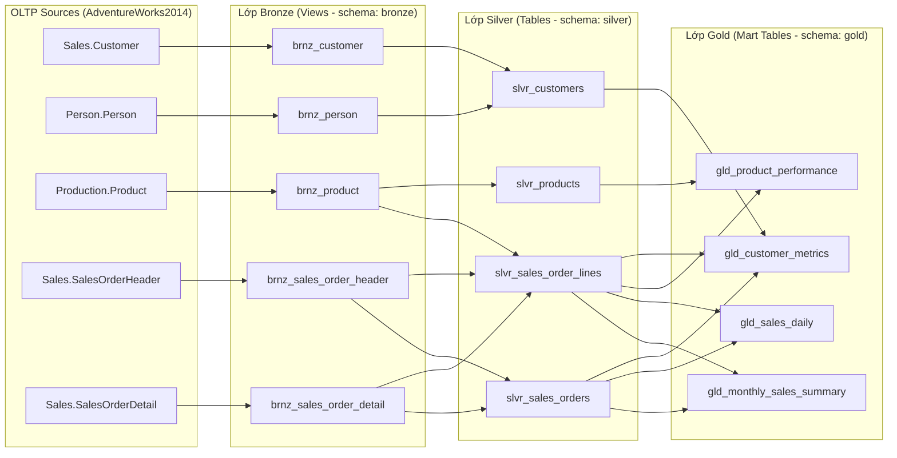

# Tài liệu Mô hình Dữ liệu & Kiểm thử DBT (Data Model & Test Documentation)

Tài liệu này mô tả chính thức kiến trúc mô hình dữ liệu **Medallion (Bronze – Silver – Gold)**, phả hệ dữ liệu (**Data Lineage**), từ điển dữ liệu (**Data Dictionary**) và hệ thống kiểm thử tự động (**Automated Data Quality Tests**) của dự án DataOps trên cơ sở dữ liệu **AdventureWorks2014 (SQL Server)**.

Tên model, tên cột, tên kiểm thử, giá trị enum, công thức và tham số kỹ thuật được giữ nguyên để đối chiếu trực tiếp với mã nguồn DBT (`_sources.yml`, `_bronze__models.yml`, `_silver__models.yml`, `_gold__models.yml` và `dbt/tests/`).

- **Tên dự án DBT:** `dbt_sqlserver_project`
- **Phiên bản metadata DBT:** `version: 2`
- **Kiến trúc mô hình:** 5 Sources → 5 Bronze Views → 4 Silver Tables → 4 Gold Mart Tables (Tổng cộng **13 models**)

---

## 1. Kiến trúc Đa tầng & Sơ đồ Phả hệ Dữ liệu (Data Lineage)

### 1.1 Sơ đồ Luồng Dữ liệu (Mermaid Lineage Graph)

### 1.2 Tổng hợp các Lớp Mô hình

| Lớp (Layer) | Schema đích | Materialization | Tag DBT | Số lượng | Vai trò chính |
|---|---|---|---|---|---|
| **Sources** | `Sales`, `Production`, `Person` | Bảng gốc OLTP | — | 5 bảng | Dữ liệu giao dịch và danh mục gốc từ `AdventureWorks2014`, có kiểm tra độ mới (`freshness`). |
| **Bronze** | `dbo_bronze` (`+schema: bronze`) | `view` | `tag:bronze` | 5 models | Tiếp nhận 1:1 từ nguồn, chuẩn hóa tên cột `snake_case`, ép kiểu tường minh, `ltrim/rtrim`, loại bỏ cột nhạy cảm/kỹ thuật (`rowguid`, XML, thẻ tín dụng). |
| **Silver** | `dbo_silver` (`+schema: silver`) | `table` | `tag:silver` | 4 models | Giải mã mã code (`CASE WHEN`), kết nối thực thể (Join), tính toán chỉ số dòng/đơn hàng, lọc bỏ đơn bị hủy/từ chối (`order_status_code IN (4, 6)`). |
| **Gold** | `dbo_gold` (`+schema: gold`) | `table` | `tag:gold` | 4 models | Các bảng Mart phân tích đa chiều (Khách hàng, Sản phẩm, Doanh thu Ngày, Tổng hợp Tháng & Tăng trưởng MoM) sẵn sàng cho BI/Dashboard. |

---

## 2. Nguồn Dữ liệu & Kiểm tra Độ tươi mới (`_sources.yml`)

Tất cả các nguồn dữ liệu đều được cấu hình kiểm tra độ mới (**Source Freshness**) dựa trên trường `ModifiedDate` thông qua lệnh `dbt source freshness`:

| Tên Source | Schema gốc | Bảng nguồn | Khóa chính | Cột kiểm tra độ mới | Ngưỡng cảnh báo (`warn_after`) | Kỳ vọng độ trễ (Expected Latency) |
|---|---|---|---|---|---|---|
| `sales` | `Sales` | `SalesOrderHeader` | `SalesOrderID` | `ModifiedDate` | `24 hour` | Dữ liệu đơn hàng OLTP cập nhật liên tục mỗi ngày. |
| `sales` | `Sales` | `SalesOrderDetail` | `SalesOrderDetailID` | `ModifiedDate` | `24 hour` | Dữ liệu chi tiết dòng đơn hàng cập nhật liên tục mỗi ngày. |
| `sales` | `Sales` | `Customer` | `CustomerID` | `ModifiedDate` | `24 hour` | Danh mục khách hàng cập nhật hàng ngày theo giao dịch mới. |
| `production` | `Production` | `Product` | `ProductID` | `ModifiedDate` | `7 day` | Dữ liệu danh mục sản phẩm (Master Data) thay đổi chậm, kiểm tra theo tuần. |
| `person` | `Person` | `Person` | `BusinessEntityID` | `ModifiedDate` | `7 day` | Thông tin định danh cá nhân thay đổi chậm, kiểm tra theo tuần. |

> **Lưu ý kỹ thuật:** Vì `AdventureWorks2014` là tập dữ liệu mẫu tĩnh (dữ liệu cập nhật cuối vào năm 2014), cấu hình freshness sử dụng `warn_after` (không đặt `error_after`) để ghi nhận cảnh báo dữ liệu cũ mà không làm dừng cứng pipeline.

---

## 3. Lớp Bronze (`dbt/models/bronze/`)

### 3.1 `brnz_sales_order_header`
- **File SQL:** `dbt/models/bronze/brnz_sales_order_header.sql`
- **Nguồn:** `{{ source('sales', 'SalesOrderHeader') }}`
- **Mức chi tiết (Grain):** Mỗi dòng tương ứng với 1 đơn hàng (`1:1` với nguồn — 31,465 dòng).
- **Mô tả:** Đổi tên cột sang `snake_case`, ép kiểu dữ liệu tường minh và cắt khoảng trắng thừa. Loại bỏ các cột kỹ thuật và nhạy cảm (`rowguid`, `CreditCardID`, `CreditCardApprovalCode`, các ID địa chỉ, `CurrencyRateID`, `RevisionNumber`, `Comment`).

| Tên cột | Mô tả | Kiểm thử (Tests) |
|---|---|---|
| `sales_order_id` | Khóa chính của đơn hàng (`SalesOrderID`). | `unique`, `not_null` |
| `order_date` | Ngày tạo đơn hàng. | — |
| `due_date` | Ngày đơn hàng đến hạn giao cho khách. | — |
| `ship_date` | Ngày đơn hàng được giao cho khách (`NULL` nếu chưa giao). | — |
| `order_status_code` | Mã trạng thái đơn hàng: `1` Đang xử lý, `2` Đã duyệt, `3` Đang chờ hàng, `4` Bị từ chối, `5` Đã giao, `6` Đã hủy. | `accepted_values: [1, 2, 3, 4, 5, 6]` |
| `is_online_order` | `1` = khách đặt trực tuyến (Online); `0` = nhân viên bán hàng đặt đơn cho đại lý (Reseller). | `accepted_values: [0, 1]` |
| `sales_order_number` | Mã nghiệp vụ của đơn hàng (ví dụ: `SO43659`). | — |
| `purchase_order_number` | Mã tham chiếu đơn đặt hàng của khách (`NULL` đối với đơn hàng trực tuyến). | — |
| `account_number` | Mã tham chiếu tài khoản kế toán tài chính. | — |
| `customer_id` | Mã khách hàng (khóa ngoại đến `Sales.Customer`). | `not_null`, `relationships: ref('brnz_customer').customer_id` |
| `sales_person_id` | Mã nhân viên bán hàng tạo đơn (`NULL` đối với đơn trực tuyến). | `relationships: ref('brnz_person').person_id` |
| `territory_id` | Mã khu vực bán hàng. | — |
| `ship_method_id` | Mã phương thức vận chuyển. | — |
| `subtotal_amount` | Tổng tiền hàng trước thuế và phí vận chuyển. | — |
| `tax_amount` | Tiền thuế. | — |
| `freight_amount` | Phí vận chuyển. | — |
| `total_due_amount` | Tổng số tiền khách phải thanh toán (`subtotal + tax + freight`). | — |
| `modified_at` | Ngày giờ bản ghi nguồn được cập nhật lần cuối. | — |

---

### 3.2 `brnz_sales_order_detail`
- **File SQL:** `dbt/models/bronze/brnz_sales_order_detail.sql`
- **Nguồn:** `{{ source('sales', 'SalesOrderDetail') }}`
- **Mức chi tiết (Grain):** Mỗi dòng tương ứng với 1 dòng chi tiết đơn hàng (`1:1` với nguồn — 121,317 dòng).
- **Mô tả:** Chuẩn hóa tên cột `snake_case`, ép kiểu tường minh, loại bỏ khoảng trắng thừa và cột `rowguid`.

| Tên cột | Mô tả | Kiểm thử (Tests) |
|---|---|---|
| `sales_order_detail_id` | Khóa chính của dòng hàng (`SalesOrderDetailID`). | `unique`, `not_null` |
| `sales_order_id` | Đơn hàng chứa dòng hàng này. | `not_null`, `relationships: ref('brnz_sales_order_header').sales_order_id` |
| `product_id` | Sản phẩm được bán. | `not_null`, `relationships: ref('brnz_product').product_id` |
| `special_offer_id` | Mã chương trình khuyến mại/ưu đãi áp dụng cho dòng hàng. | — |
| `carrier_tracking_number` | Mã vận đơn do đơn vị vận chuyển cung cấp (`NULL` với đơn trực tuyến). | — |
| `order_qty` | Số lượng sản phẩm được đặt. | — |
| `unit_price` | Giá bán của một đơn vị sản phẩm. | — |
| `unit_price_discount_pct` | Tỷ lệ chiết khấu áp dụng trên đơn giá (`0 - 1`, ví dụ `0.10 = 10%`). | — |
| `line_total` | Thành tiền dòng hàng: `unit_price * (1 - unit_price_discount_pct) * order_qty`. | — |
| `modified_at` | Ngày giờ bản ghi nguồn được cập nhật lần cuối. | — |

---

### 3.3 `brnz_product`
- **File SQL:** `dbt/models/bronze/brnz_product.sql`
- **Nguồn:** `{{ source('production', 'Product') }}`
- **Mức chi tiết (Grain):** Mỗi dòng tương ứng với 1 sản phẩm (`1:1` với nguồn — 504 dòng).
- **Mô tả:** Chuẩn hóa danh mục sản phẩm, cắt khoảng trắng thừa cho các cột mã `nchar(2)` (`ProductLine`, `Class`, `Style`) và loại bỏ `rowguid`.

| Tên cột | Mô tả | Kiểm thử (Tests) |
|---|---|---|
| `product_id` | Khóa chính của sản phẩm (`ProductID`). | `unique`, `not_null` |
| `product_name` | Tên sản phẩm. | — |
| `product_number` | Mã định danh sản phẩm duy nhất (ví dụ: `BK-R93R-62`). | — |
| `is_manufactured_in_house` | `1` = sản xuất nội bộ; `0` = mua ngoài. | `accepted_values: [0, 1]` |
| `is_finished_good` | `1` = thành phẩm có thể bán; `0` = linh kiện không bán lẻ. | `accepted_values: [0, 1]` |
| `color` | Màu sản phẩm (`NULL` nếu không áp dụng). | — |
| `safety_stock_level` | Số lượng tồn kho an toàn tối thiểu. | — |
| `reorder_point` | Mức tồn kho kích hoạt đặt hàng/sản xuất bổ sung. | — |
| `standard_cost` | Giá vốn tiêu chuẩn của sản phẩm. | — |
| `list_price` | Giá niêm yết (`0` đối với linh kiện không bán). | — |
| `size` | Kích thước sản phẩm. | — |
| `size_unit` | Đơn vị đo kích thước. | — |
| `weight_unit` | Đơn vị đo khối lượng. | — |
| `weight` | Khối lượng sản phẩm. | — |
| `days_to_manufacture` | Số ngày cần để sản xuất sản phẩm. | — |
| `product_line_code` | Mã dòng sản phẩm: `R` Road, `M` Mountain, `T` Touring, `S` Standard (`NULL` nếu không áp dụng). | `accepted_values: ['R', 'M', 'T', 'S']` |
| `class_code` | Mã phân hạng: `H` High, `M` Medium, `L` Low. | `accepted_values: ['H', 'M', 'L']` |
| `style_code` | Mã kiểu dáng: `W` Womens, `M` Mens, `U` Universal. | `accepted_values: ['W', 'M', 'U']` |
| `product_subcategory_id` | Mã danh mục con của sản phẩm (`NULL` đối với linh kiện). | — |
| `product_model_id` | Mã mẫu sản phẩm (`ProductModelID`). | — |
| `sell_start_date` | Ngày bắt đầu mở bán. | — |
| `sell_end_date` | Ngày ngừng bán. | — |
| `discontinued_date` | Ngày ngừng kinh doanh. | — |
| `modified_at` | Ngày giờ bản ghi nguồn được cập nhật lần cuối. | — |

---

### 3.4 `brnz_customer`
- **File SQL:** `dbt/models/bronze/brnz_customer.sql`
- **Nguồn:** `{{ source('sales', 'Customer') }}`
- **Mức chi tiết (Grain):** Mỗi dòng tương ứng với 1 khách hàng (`1:1` với nguồn — 19,820 dòng).
- **Mô tả:** Tiếp nhận bảng `Sales.Customer`, bổ sung 2 cờ nhị phân `is_individual` và `is_store_customer` để phân biệt khách lẻ cá nhân và tài khoản cửa hàng/đại lý bán buôn.

| Tên cột | Mô tả | Kiểm thử (Tests) |
|---|---|---|
| `customer_id` | Khóa chính của bản ghi khách hàng (`CustomerID`). | `unique`, `not_null` |
| `person_id` | Khóa ngoại tới `Person.Person` (có giá trị đối với khách lẻ cá nhân, `NULL` với cửa hàng). | `relationships: ref('brnz_person').person_id` |
| `store_id` | Khóa ngoại tới `Sales.Store` (có giá trị đối với tài khoản cửa hàng/đại lý, `NULL` với cá nhân). | — |
| `territory_id` | Mã khu vực bán hàng của khách hàng. | — |
| `account_number` | Mã số tài khoản khách hàng (ví dụ: `AW00000001`). | — |
| `is_individual` | `1` nếu là khách hàng cá nhân bán lẻ (`person_id IS NOT NULL`), ngược lại `0`. | `accepted_values: [0, 1]` |
| `is_store_customer` | `1` nếu là khách hàng cửa hàng/đại lý bán buôn (`store_id IS NOT NULL`), ngược lại `0`. | `accepted_values: [0, 1]` |
| `modified_at` | Ngày giờ bản ghi nguồn được cập nhật lần cuối. | — |

---

### 3.5 `brnz_person`
- **File SQL:** `dbt/models/bronze/brnz_person.sql`
- **Nguồn:** `{{ source('person', 'Person') }}`
- **Mức chi tiết (Grain):** Mỗi dòng tương ứng với 1 định danh cá nhân (`1:1` với nguồn — 19,972 dòng).
- **Mô tả:** Tiếp nhận thông tin họ tên và tùy chọn tiếp thị email từ `Person.Person`. Loại bỏ các cột kỹ thuật và cột XML nặng (`rowguid`, `Demographics`, `AdditionalContactInfo`).

| Tên cột | Mô tả | Kiểm thử (Tests) |
|---|---|---|
| `person_id` | Khóa chính định danh cá nhân (`BusinessEntityID`). | `unique`, `not_null` |
| `person_type_code` | Mã loại cá nhân: `SC` Store Contact, `IN` Individual Customer, `SP` Sales Person, `EM` Employee, `VC` Vendor Contact, `GC` General Contact. | `accepted_values: ['SC', 'IN', 'SP', 'EM', 'VC', 'GC']` |
| `title` | Danh xưng (ví dụ: `Mr.`, `Ms.`; `NULL` nếu không có). | — |
| `first_name` | Tên. | — |
| `middle_name` | Tên đệm (`NULL` nếu không có). | — |
| `last_name` | Họ. | — |
| `suffix` | Hậu tố tên (ví dụ: `Jr.`, `Sr.`, `III`; `NULL` nếu không có). | — |
| `email_promotion_code` | Tùy chọn nhận email quảng cáo: `0` Không nhận, `1` Nhận từ AdventureWorks, `2` Nhận từ AdventureWorks và đối tác. | `accepted_values: [0, 1, 2]` |
| `modified_at` | Ngày giờ bản ghi nguồn được cập nhật lần cuối. | — |

---

## 4. Lớp Silver (`dbt/models/silver/`)

### 4.1 `slvr_products`
- **File SQL:** `dbt/models/silver/slvr_products.sql`
- **Nguồn tham chiếu:** `{{ ref('brnz_product') }}`
- **Mức chi tiết (Grain):** Mỗi dòng là 1 sản phẩm (504 dòng, giữ nguyên cả sản phẩm chưa từng bán để phục vụ phân tích danh mục ở tầng Gold).
- **Mô tả:** Giải mã các mã viết tắt (`product_line_code`, `class_code`, `style_code`) sang tên đầy đủ, tính biên lợi nhuận đơn vị (`unit_margin`), phân tầng mức giá (`price_tier`) và xác định trạng thái đang kinh doanh (`is_active`).

| Tên cột | Mô tả | Kiểm thử (Tests) |
|---|---|---|
| `product_id` | Khóa chính của sản phẩm. | `unique`, `not_null` |
| `product_name` | Tên sản phẩm. | — |
| `product_number` | Mã định danh sản phẩm duy nhất. | — |
| `product_subcategory_id` | Mã danh mục con của sản phẩm (`NULL` đối với linh kiện). | — |
| `color` | Màu sản phẩm; thay thế `NULL` bằng `'N/A'`. | — |
| `standard_cost` | Giá vốn tiêu chuẩn. | — |
| `list_price` | Giá niêm yết. | — |
| `unit_margin` | Biên lợi nhuận lý thuyết trên mỗi đơn vị: `list_price - standard_cost`. | — |
| `product_line` | Dòng sản phẩm đã giải mã (`Road`, `Mountain`, `Touring`, `Standard`, `Unknown`). | `accepted_values: ['Road', 'Mountain', 'Touring', 'Standard', 'Unknown']` |
| `product_class` | Phân hạng đã giải mã (`High`, `Medium`, `Low`, `Unknown`). | `accepted_values: ['High', 'Medium', 'Low', 'Unknown']` |
| `product_style` | Kiểu dáng đã giải mã (`Women`, `Men`, `Universal`, `Unknown`). | `accepted_values: ['Women', 'Men', 'Universal', 'Unknown']` |
| `product_type` | Loại sản phẩm: `'Finished Good'` (thành phẩm) hoặc `'Component'` (linh kiện). | `accepted_values: ['Finished Good', 'Component']` |
| `price_tier` | Phân khúc giá niêm yết: `'Not For Sale'` (`= 0`), `'Low'` (`< 100`), `'Mid'` (`< 1000`), `'Premium'` (`>= 1000`). | `accepted_values: ['Not For Sale', 'Low', 'Mid', 'Premium']` |
| `is_active` | `1` nếu sản phẩm vẫn đang mở bán (`sell_end_date IS NULL` và `discontinued_date IS NULL`), ngược lại `0`. | `accepted_values: [0, 1]` |
| `sell_start_date` | Ngày bắt đầu mở bán. | — |
| `sell_end_date` | Ngày ngừng bán. | — |
| `modified_at` | Ngày giờ bản ghi nguồn được cập nhật lần cuối. | — |

---

### 4.2 `slvr_customers`
- **File SQL:** `dbt/models/silver/slvr_customers.sql`
- **Nguồn tham chiếu:** `{{ ref('brnz_customer') }}` LEFT JOIN `{{ ref('brnz_person') }}`
- **Mức chi tiết (Grain):** Mỗi dòng là 1 khách hàng (19,820 dòng).
- **Mô tả:** Chiều khách hàng hoàn chỉnh kết hợp thông tin tài khoản khách hàng và định danh cá nhân. Ghép họ tên đầy đủ (`full_name`) hoặc gán tên định danh cửa hàng `Store #...` cho đại lý bán buôn, phân loại khách hàng (`customer_type`) và giải mã kênh nhận quảng cáo email.

| Tên cột | Mô tả | Kiểm thử (Tests) |
|---|---|---|
| `customer_id` | Khóa chính của khách hàng. | `unique`, `not_null` |
| `account_number` | Mã số tài khoản khách hàng. | `unique`, `not_null` |
| `person_id` | Mã định danh cá nhân (`NULL` với tài khoản cửa hàng). | — |
| `store_id` | Mã cửa hàng (`NULL` với khách lẻ cá nhân). | — |
| `territory_id` | Mã khu vực bán hàng. | — |
| `first_name` | Tên khách hàng (`NULL` với tài khoản cửa hàng). | — |
| `last_name` | Họ khách hàng (`NULL` với tài khoản cửa hàng). | — |
| `full_name` | Họ tên đầy đủ đã chuẩn hóa (hoặc `'Store #' + store_id` nếu là đại lý). | `not_null` |
| `customer_type` | Phân loại khách hàng: `'Retail Individual'`, `'Wholesale Store'`, hoặc `'Other'`. | `accepted_values: ['Retail Individual', 'Wholesale Store', 'Other']` |
| `email_promotion` | Kênh tiếp thị email đã giải mã: `'No'`, `'Direct Channel'`, `'Partner Channel'`, `'Unknown'`. | `accepted_values: ['No', 'Direct Channel', 'Partner Channel', 'Unknown']` |
| `is_individual` | Cờ khách hàng cá nhân (`0` hoặc `1`). | `accepted_values: [0, 1]` |
| `is_store_customer` | Cờ khách hàng cửa hàng bán buôn (`0` hoặc `1`). | `accepted_values: [0, 1]` |
| `modified_at` | Thời điểm cập nhật gần nhất. | — |

---

### 4.3 `slvr_sales_order_lines`
- **File SQL:** `dbt/models/silver/slvr_sales_order_lines.sql`
- **Nguồn tham chiếu:** `{{ ref('brnz_sales_order_detail') }}` INNER JOIN `{{ ref('brnz_sales_order_header') }}` LEFT JOIN `{{ ref('brnz_product') }}`
- **Mức chi tiết (Grain):** Mỗi dòng là 1 dòng chi tiết đơn hàng hợp lệ (121,317 dòng).
- **Mô tả:** Bảng Fact chi tiết cấp dòng hàng. Giải mã kênh bán (`order_channel`), trạng thái đơn (`order_status`), tính toán doanh thu gộp (`gross_amount`), tiền chiết khấu (`discount_amount`), doanh thu thuần (`net_amount`), giá vốn (`cost_amount`) và lợi nhuận gộp (`gross_profit`). Lọc bỏ các dòng có `order_qty <= 0`, `unit_price < 0`, hoặc đơn bị từ chối/đã hủy (`order_status_code IN (4, 6)`).

| Tên cột | Mô tả | Kiểm thử (Tests) |
|---|---|---|
| `sales_order_detail_id` | Khóa chính của dòng đơn hàng. | `unique`, `not_null` |
| `sales_order_id` | Mã đơn hàng chứa dòng hàng này. | `not_null`, `relationships: ref('slvr_sales_orders').sales_order_id` |
| `sales_order_number` | Mã nghiệp vụ của đơn hàng. | — |
| `product_id` | Mã sản phẩm được bán. | `not_null`, `relationships: ref('slvr_products').product_id` |
| `customer_id` | Mã khách hàng đặt đơn. | `not_null`, `relationships: ref('slvr_customers').customer_id` |
| `territory_id` | Mã khu vực bán hàng. | — |
| `order_date` | Ngày đặt hàng (`date`). | `not_null`, **`no_future_dates`**, **`valid_date_range`** (`2010-01-01` .. `2030-12-31`) |
| `order_year` | Năm đặt hàng theo lịch. | — |
| `order_month` | Tháng đặt hàng theo lịch (`1..12`). | `not_null`, `accepted_values: [1..12]` |
| `order_channel` | Kênh đặt hàng: `'Online'` hoặc `'Reseller'`. | `accepted_values: ['Online', 'Reseller']` |
| `order_status` | Trạng thái đơn hàng đã giải mã (đã loại bỏ Rejected/Cancelled). | `accepted_values: ['In Process', 'Approved', 'Backordered', 'Shipped']` |
| `order_qty` | Số lượng đặt mua. | `not_null`, **`is_positive`** |
| `unit_price` | Đơn giá bán. | `not_null`, **`is_positive`** (`allow_zero: true`) |
| `unit_price_discount_pct` | Tỷ lệ chiết khấu (`0 - 1`). | — |
| `gross_amount` | Doanh thu trước chiết khấu: `unit_price * order_qty`. | — |
| `discount_amount` | Số tiền chiết khấu: `gross_amount - net_amount`. | — |
| `net_amount` | Doanh thu thuần sau chiết khấu (`LineTotal`). | `not_null` |
| `standard_cost` | Giá vốn tiêu chuẩn hiện tại của sản phẩm. | — |
| `cost_amount` | Tổng giá vốn hàng bán: `standard_cost * order_qty`. | — |
| `gross_profit` | Lợi nhuận gộp: `net_amount - cost_amount`. | — |
| `has_discount` | `1` nếu dòng hàng có chiết khấu (`unit_price_discount_pct > 0`), ngược lại `0`. | `accepted_values: [0, 1]` |

---

### 4.4 `slvr_sales_orders`
- **File SQL:** `dbt/models/silver/slvr_sales_orders.sql`
- **Nguồn tham chiếu:** `{{ ref('brnz_sales_order_header') }}` LEFT JOIN (tổng hợp theo đơn từ `{{ ref('brnz_sales_order_detail') }}`)
- **Mức chi tiết (Grain):** Mỗi dòng là 1 đơn hàng hợp lệ (31,465 dòng).
- **Mô tả:** Bảng Fact cấp đơn hàng. Kết hợp thông tin header với tổng số dòng hàng (`line_count`), tổng số lượng (`total_units`), tổng tiền dòng hàng (`lines_subtotal`), chỉ số thời gian giao hàng (`days_to_ship`, `is_late_shipment`) và cờ đối soát tổng tiền (`is_subtotal_reconciled`).

| Tên cột | Mô tả | Kiểm thử (Tests) |
|---|---|---|
| `sales_order_id` | Khóa chính của đơn hàng. | `unique`, `not_null` |
| `sales_order_number` | Mã nghiệp vụ của đơn hàng. | — |
| `customer_id` | Mã khách hàng đặt đơn. | `not_null`, `relationships: ref('slvr_customers').customer_id` |
| `sales_person_id` | Mã nhân viên bán hàng (`NULL` với đơn trực tuyến). | — |
| `territory_id` | Mã khu vực bán hàng. | — |
| `order_channel` | Kênh bán: `'Online'` hoặc `'Reseller'`. | `accepted_values: ['Online', 'Reseller']` |
| `order_status` | Trạng thái đơn hàng đã giải mã. | `accepted_values: ['In Process', 'Approved', 'Backordered', 'Shipped']` |
| `order_date` | Ngày đặt hàng. | — |
| `due_date` | Ngày hẹn giao hàng. | — |
| `ship_date` | Ngày thực tế giao hàng (`NULL` nếu chưa giao). | — |
| `days_to_ship` | Số ngày từ lúc đặt đến lúc giao (`datediff(day, order_date, ship_date)`). | — |
| `is_late_shipment` | `1` nếu giao trễ hạn (`ship_date > due_date`), ngược lại `0`. | `accepted_values: [0, 1]` |
| `line_count` | Số lượng dòng hàng trong đơn. | — |
| `total_units` | Tổng số lượng sản phẩm trong đơn. | — |
| `subtotal_amount` | Tiền hàng trước thuế/phí ghi trên Header. | — |
| `tax_amount` | Tiền thuế của đơn hàng. | — |
| `freight_amount` | Phí vận chuyển của đơn hàng. | — |
| `total_due_amount` | Tổng tiền thanh toán của đơn hàng. | — |
| `lines_subtotal` | Tổng `line_total` cộng dồn từ các dòng chi tiết đơn hàng. | — |
| `is_subtotal_reconciled` | Cờ đối soát chất lượng dữ liệu: `1` nếu `abs(subtotal_amount - lines_subtotal) <= 0.01`, ngược lại `0`. | `accepted_values: [0, 1]` |

---

## 5. Lớp Gold (`dbt/models/gold/`)

### 5.1 `gld_sales_daily`
- **File SQL:** `dbt/models/gold/gld_sales_daily.sql`
- **Nguồn tham chiếu:** `{{ ref('slvr_sales_order_lines') }}` JOIN `{{ ref('slvr_sales_orders') }}`
- **Mức chi tiết (Grain):** `order_date × order_channel` (1,124 dòng).
- **Kiểm thử cấp mô hình:** `dbt_utils.unique_combination_of_columns: [order_date, order_channel]`
- **Mô tả:** Bảng Mart tổng hợp KPI doanh thu, chi phí, lợi nhuận, biên lợi nhuận, giá trị đơn trung bình (AOV), thuế, phí vận chuyển và số đơn giao trễ theo từng ngày và kênh bán.

| Tên cột | Mô tả | Kiểm thử (Tests) |
|---|---|---|
| `order_date` | Ngày đặt hàng. | `not_null` |
| `order_channel` | Kênh bán hàng (`'Online'` hoặc `'Reseller'`). | `not_null`, `accepted_values: ['Online', 'Reseller']` |
| `total_orders` | Tổng số đơn hàng duy nhất trong ngày theo kênh. | — |
| `unique_customers` | Số lượng khách hàng duy nhất đặt hàng. | — |
| `total_units` | Tổng số đơn vị sản phẩm đã bán. | — |
| `gross_revenue` | Tổng doanh thu gộp trước chiết khấu. | — |
| `discount_amount` | Tổng tiền chiết khấu. | — |
| `net_revenue` | Tổng doanh thu thuần sau chiết khấu. | — |
| `cost_amount` | Tổng giá vốn hàng bán. | — |
| `gross_profit` | Tổng lợi nhuận gộp (`net_revenue - cost_amount`). | — |
| `gross_margin_pct` | Tỷ suất lợi nhuận gộp (`gross_profit / net_revenue`). | — |
| `avg_order_value` | Giá trị đơn hàng trung bình (`net_revenue / total_orders`). | — |
| `tax_amount` | Tổng tiền thuế (tổng hợp ở cấp đơn hàng, không bị nhân bản theo dòng). | — |
| `freight_amount` | Tổng phí vận chuyển (tổng hợp ở cấp đơn hàng). | — |
| `late_shipments` | Số đơn hàng bị giao trễ hạn. | — |

---

### 5.2 `gld_product_performance`
- **File SQL:** `dbt/models/gold/gld_product_performance.sql`
- **Nguồn tham chiếu:** `{{ ref('slvr_products') }}` LEFT JOIN `{{ ref('slvr_sales_order_lines') }}`
- **Mức chi tiết (Grain):** Mỗi dòng là 1 sản phẩm (`product_id` — 504 dòng, bao gồm cả sản phẩm chưa phát sinh doanh thu).
- **Mô tả:** Bảng Mart đánh giá hiệu quả kinh doanh và xếp hạng doanh thu của từng sản phẩm (`DENSE_RANK() OVER (ORDER BY net_revenue DESC)`).

| Tên cột | Mô tả | Kiểm thử (Tests) |
|---|---|---|
| `product_id` | Khóa chính của sản phẩm. | `unique`, `not_null`, `relationships: ref('slvr_products').product_id` |
| `product_name` | Tên sản phẩm. | — |
| `product_number` | Mã định danh sản phẩm. | — |
| `product_line` | Dòng sản phẩm (`Road`, `Mountain`, `Touring`, `Standard`, `Unknown`). | `accepted_values: ['Road', 'Mountain', 'Touring', 'Standard', 'Unknown']` |
| `product_type` | Loại sản phẩm (`Finished Good` hoặc `Component`). | `accepted_values: ['Finished Good', 'Component']` |
| `price_tier` | Phân khúc giá niêm yết (`Not For Sale`, `Low`, `Mid`, `Premium`). | `accepted_values: ['Not For Sale', 'Low', 'Mid', 'Premium']` |
| `is_active` | `1` nếu sản phẩm vẫn đang mở bán, ngược lại `0`. | `accepted_values: [0, 1]` |
| `list_price` | Giá niêm yết hiện tại. | — |
| `standard_cost` | Giá vốn tiêu chuẩn hiện tại. | — |
| `total_orders` | Tổng số đơn hàng có chứa sản phẩm. | — |
| `total_units` | Tổng số lượng đơn vị sản phẩm đã bán. | — |
| `net_revenue` | Tổng doanh thu thuần của sản phẩm. | — |
| `discount_amount` | Tổng số tiền chiết khấu của sản phẩm. | — |
| `cost_amount` | Tổng giá vốn hàng bán của sản phẩm. | — |
| `gross_profit` | Tổng lợi nhuận gộp (`net_revenue - cost_amount`). | — |
| `gross_margin_pct` | Tỷ suất lợi nhuận gộp (`gross_profit / net_revenue`; `NULL` nếu chưa có doanh thu). | — |
| `avg_selling_price` | Giá bán thực tế bình quân mỗi đơn vị (`net_revenue / total_units`). | — |
| `first_sale_date` | Ngày bán đầu tiên (`NULL` nếu chưa từng bán). | — |
| `last_sale_date` | Ngày bán gần nhất (`NULL` nếu chưa từng bán). | — |
| `has_sales` | `1` nếu sản phẩm đã từng phát sinh doanh số (`total_orders > 0`), ngược lại `0`. | `accepted_values: [0, 1]` |
| `revenue_rank` | Thứ hạng sản phẩm theo doanh thu thuần cao nhất (`1` = cao nhất). | — |

---

### 5.3 `gld_customer_metrics`
- **File SQL:** `dbt/models/gold/gld_customer_metrics.sql`
- **Nguồn tham chiếu:** `{{ ref('slvr_customers') }}`, `{{ ref('slvr_sales_orders') }}`, `{{ ref('slvr_sales_order_lines') }}`
- **Mức chi tiết (Grain):** Mỗi dòng là 1 khách hàng (`customer_id` — 19,820 dòng).
- **Mô tả:** Bảng Mart phân tích Giá trị Vòng đời Khách hàng (**Customer Lifetime Value - LTV**), tần suất mua hàng, độ trễ mua hàng gần nhất (`days_since_last_order`) và phân khúc khách hàng tự động (`customer_segment`).

| Tên cột | Mô tả | Kiểm thử (Tests) |
|---|---|---|
| `customer_id` | Khóa chính của khách hàng. | `unique`, `not_null`, `relationships: ref('slvr_customers').customer_id` |
| `account_number` | Mã số tài khoản khách hàng. | `unique`, `not_null` |
| `full_name` | Họ tên khách hàng hoặc tên định danh cửa hàng. | — |
| `customer_type` | Loại khách hàng (`'Retail Individual'`, `'Wholesale Store'`, `'Other'`). | `accepted_values: ['Retail Individual', 'Wholesale Store', 'Other']` |
| `territory_id` | Mã khu vực bán hàng. | — |
| `email_promotion` | Tùy chọn nhận email tiếp thị. | `accepted_values: ['No', 'Direct Channel', 'Partner Channel', 'Unknown']` |
| `total_orders` | Tổng số đơn hàng khách đã đặt. | — |
| `total_units_purchased` | Tổng số lượng sản phẩm khách đã mua. | — |
| `lifetime_revenue` | Tổng doanh thu thuần trọn đời (LTV) đóng góp bởi khách hàng. | — |
| `lifetime_discount_amount` | Tổng số tiền chiết khấu khách hàng đã nhận. | — |
| `lifetime_gross_profit` | Tổng lợi nhuận gộp trọn đời từ khách hàng. | — |
| `lifetime_margin_pct` | Tỷ suất lợi nhuận gộp trọn đời từ khách hàng. | — |
| `avg_order_value` | Giá trị đơn hàng trung bình của khách (`lifetime_revenue / total_orders`). | — |
| `first_order_date` | Ngày mua hàng đầu tiên (`NULL` nếu chưa mua). | — |
| `last_order_date` | Ngày mua hàng gần nhất (`NULL` nếu chưa mua). | — |
| `days_since_last_order` | Số ngày kể từ lần mua gần nhất so với ngày đơn hàng cuối cùng trong hệ thống. | — |
| `customer_segment` | Phân khúc khách hàng: - `'Prospect / No Purchase'`: `total_orders = 0` - `'VIP Customer'`: `lifetime_revenue >= 10,000` hoặc `total_orders >= 10` - `'Loyal Customer'`: `lifetime_revenue >= 2,500` hoặc `total_orders >= 4` - `'Regular Customer'`: `total_orders >= 2` - `'One-Time Buyer'`: `total_orders = 1` | `accepted_values: ['VIP Customer', 'Loyal Customer', 'Regular Customer', 'One-Time Buyer', 'Prospect / No Purchase']` |
| `has_orders` | `1` nếu khách hàng đã có ít nhất 1 đơn hàng, ngược lại `0`. | `accepted_values: [0, 1]` |

---

### 5.4 `gld_monthly_sales_summary`
- **File SQL:** `dbt/models/gold/gld_monthly_sales_summary.sql`
- **Nguồn tham chiếu:** `{{ ref('slvr_sales_order_lines') }}`, `{{ ref('slvr_sales_orders') }}`
- **Mức chi tiết (Grain):** `order_year × order_month` (38 dòng — từ tháng `2011-05` đến `2014-06`).
- **Kiểm thử cấp mô hình:** `dbt_utils.unique_combination_of_columns: [order_year, order_month]`
- **Mô tả:** Bảng Mart tổng hợp kết quả kinh doanh theo tháng dành cho Ban điều hành (Executive Summary), bao gồm cơ cấu doanh thu theo kênh (`Online` vs `Reseller`), tỷ trọng doanh thu trực tuyến (`online_revenue_share_pct`), và tốc độ tăng trưởng doanh thu tháng sau so với tháng trước (**MoM Growth %** dùng hàm cửa sổ `LAG()`).

| Tên cột | Mô tả | Kiểm thử (Tests) |
|---|---|---|
| `order_year` | Năm đặt hàng theo lịch. | `not_null` |
| `order_month` | Tháng đặt hàng theo lịch (`1..12`). | `not_null`, `accepted_values: [1..12]` |
| `year_month_label` | Nhãn thời gian định dạng `'YYYY-MM'` (ví dụ: `'2013-05'`). | — |
| `total_orders` | Tổng số đơn hàng trong tháng. | — |
| `online_orders` | Tổng số đơn đặt hàng trực tuyến (`Online`). | — |
| `reseller_orders` | Tổng số đơn đặt hàng qua đại lý (`Reseller`). | — |
| `unique_customers` | Số lượng khách hàng duy nhất mua hàng trong tháng. | — |
| `total_units_sold` | Tổng số lượng sản phẩm bán ra trong tháng. | — |
| `gross_revenue` | Tổng doanh thu gộp trước chiết khấu. | — |
| `discount_amount` | Tổng tiền chiết khấu trong tháng. | — |
| `net_revenue` | Tổng doanh thu thuần trong tháng. | — |
| `cost_amount` | Tổng giá vốn hàng bán trong tháng. | — |
| `gross_profit` | Tổng lợi nhuận gộp trong tháng (`net_revenue - cost_amount`). | — |
| `gross_margin_pct` | Tỷ suất lợi nhuận gộp trong tháng. | — |
| `avg_order_value` | Giá trị đơn hàng trung bình trong tháng. | — |
| `online_revenue` | Doanh thu thuần từ kênh `Online`. | — |
| `reseller_revenue` | Doanh thu thuần từ kênh `Reseller`. | — |
| `online_revenue_share_pct` | Tỷ trọng doanh thu kênh `Online` trên tổng doanh thu thuần (`online_revenue / net_revenue`). | — |
| `tax_amount` | Tổng tiền thuế bán hàng trong tháng. | — |
| `freight_amount` | Tổng phí vận chuyển trong tháng. | — |
| `late_shipments` | Tổng số đơn hàng giao trễ hạn trong tháng. | — |
| `prior_month_net_revenue` | Doanh thu thuần của tháng liền trước (`LAG(net_revenue) OVER (ORDER BY order_year, order_month)`). | — |
| `mom_revenue_growth_pct` | Tỷ lệ tăng trưởng doanh thu so với tháng liền trước: `(net_revenue - prior_month_net_revenue) / prior_month_net_revenue`. | — |

---

## 6. Hệ thống Kiểm thử Chất lượng Dữ liệu Tự động (Automated Testing Framework)

Dự án triển khai **4 nhóm kiểm thử tự động** theo đúng yêu cầu DataOps:

### 6.1 Schema Tests (60+ bài kiểm thử trong các tệp YAML)
- **`unique` & `not_null`:** Áp dụng trên toàn bộ khóa chính của 13 models ở cả 3 lớp Bronze, Silver, Gold.
- **`dbt_utils.unique_combination_of_columns`:** Kiểm tra khóa chính tổ hợp cho `gld_sales_daily` (`order_date`, `order_channel`) và `gld_monthly_sales_summary` (`order_year`, `order_month`).
- **`relationships` (Toàn vẹn khóa ngoại):** Kiểm tra liên kết khóa ngoại xuyên suốt từ Bronze (`brnz_sales_order_header` -> `brnz_customer`, `brnz_person`; `brnz_sales_order_detail` -> `brnz_sales_order_header`, `brnz_product`) đến Silver và Gold (`gld_customer_metrics` -> `slvr_customers`, `gld_product_performance` -> `slvr_products`).
- **`accepted_values`:** Kiểm tra miền giá trị hợp lệ của các cột mã trạng thái, cờ nhị phân (`0/1`), kênh bán hàng (`Online/Reseller`), phân khúc giá (`price_tier`), phân khúc khách hàng (`customer_segment`) và tháng (`1..12`).

### 6.2 Custom Generic Tests (`dbt/tests/generic/`)
3 bài kiểm thử tổng quát tùy chỉnh có thể tái sử dụng trên bất kỳ model/cột nào:

| Tên Custom Generic Test | File định nghĩa | Tham số | Logic kiểm tra | Cột đang áp dụng |
|---|---|---|---|---|
| **`is_positive`** | `dbt/tests/generic/test_is_positive.sql` | `model`, `column_name`, `allow_zero=false` | Phát hiện các bản ghi có giá trị `<= 0` (hoặc `< 0` khi `allow_zero=true`). | `slvr_sales_order_lines.order_qty` (`> 0`), `slvr_sales_order_lines.unit_price` (`>= 0`) |
| **`no_future_dates`** | `dbt/tests/generic/test_no_future_dates.sql` | `model`, `column_name` | Phát hiện các bản ghi có ngày lớn hơn ngày hiện tại của hệ thống (`CAST(col AS date) > CAST(GETDATE() AS date)`). | `slvr_sales_order_lines.order_date` |
| **`valid_date_range`** | `dbt/tests/generic/test_valid_date_range.sql` | `model`, `column_name`, `min_date`, `max_date` | Phát hiện các bản ghi có ngày nằm ngoài khoảng `[min_date, max_date]`. | `slvr_sales_order_lines.order_date` (`2010-01-01` đến `2030-12-31`) |

### 6.3 Custom Singular Test — Đối soát Doanh thu Liên tầng (`dbt/tests/`)
- **File:** `dbt/tests/assert_gold_revenue_matches_silver.sql`
- **Mục đích:** Đối soát tổng doanh thu thuần (`SUM(net_amount)`) của bảng chi tiết `silver.slvr_sales_order_lines` với tổng doanh thu thuần (`SUM(net_revenue)`) của bảng tổng hợp `gold.gld_monthly_sales_summary`.
- **Điều kiện đạt (Pass condition):** Độ lệch tuyệt đối `ABS(total_silver_revenue - total_gold_revenue) <= 1.0`. Nếu vượt quá `1.0`, bài test trả về bản ghi lỗi và chặn pipeline tại cổng Reconciliation Gate trên Airflow và CI/CD.
